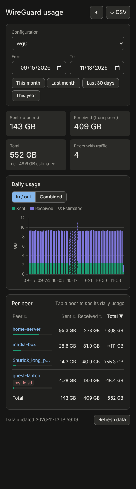
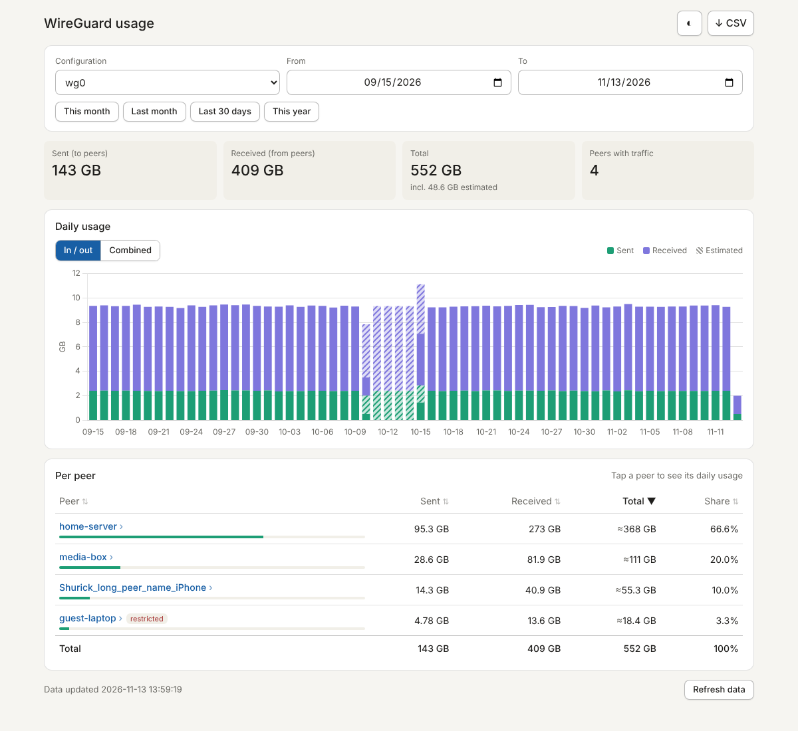

# wgdashboard-stats

[](https://github.com/shuricksumy/wgdashboard-stats/actions/workflows/docker-publish.yml)
[](https://github.com/shuricksumy/wgdashboard-stats/actions/workflows/codeql.yml)
[](https://github.com/shuricksumy/wgdashboard-stats/releases)
[](LICENSE)

Traffic reports for [WGDashboard](https://github.com/WGDashboard/WGDashboard): pick a WireGuard configuration and any date range, and see how much each peer sent and received, with a daily chart and CSV export.

WGDashboard only shows lifetime totals per peer. It does, however, record a snapshot of every running peer's counters about once a minute (the `<config>_transfer` tables, when peer tracking is on). This app reads those snapshots **read-only**, turns them into hourly usage per peer, and serves a small web page on top. Useful when you pay for egress (cloud VPS) and want to know who used what last month.

| Phone (dark theme) | Desktop |
| --- | --- |
|  |  |

## Features

- Any date range, with presets: this month, last month, last 30 days, this year
- Sent / received / total per peer and overall, with each peer's share
- Daily chart, either sent and received stacked or combined into one in + out bar; tap a peer to see only its days
- Restricted and deleted peers included
- CSV export of the selected range
- Periods when WGDashboard wasn't recording are spread out and marked *estimated* instead of showing up as one huge spike
- Light / dark / auto theme, works on phones; the selection is kept in the URL so you can bookmark a report
- Runs under its own hostname or a path such as `https://example.com/wgstat/`
- Never writes to WGDashboard's database

## Requirements

- WGDashboard with its default SQLite database (v4.x; PostgreSQL/MySQL are not supported yet)
- **Peer tracking** turned on in WGDashboard, both the global setting and per configuration. Without it there are no snapshots to read. Your history goes back as far as WGDashboard has been recording.
- Docker

## Quick start

```bash
mkdir -p wgdashboard-stats && cd wgdashboard-stats
curl -O https://raw.githubusercontent.com/shuricksumy/wgdashboard-stats/main/docker-compose.ghcr.yml
# edit the WGDashboard db path, timezone, hostname and Traefik labels, then:
docker compose -f docker-compose.ghcr.yml up -d
docker logs -f wgdashboard-stats   # the first import of a year of history takes a few seconds
```

Open the hostname (or path) you configured. To try it without a reverse proxy, uncomment the `ports:` section in the compose file and open `http://<server>:8080`.

Or build locally with `docker compose up -d --build` using [docker-compose.yml](docker-compose.yml).

### Images

Published to GitHub Container Registry as `ghcr.io/shuricksumy/wgdashboard-stats`:

| Tag | Built from |
| --- | --- |
| `latest` | the `main` branch |
| `1.0.0`, `1.0` | release tags `v1.0.0`, … (pin one of these for a stable setup) |

### Reverse proxy

The app speaks plain HTTP on port 8080; put it behind your reverse proxy and authentication (it has no login of its own). With Traefik, the compose files include example labels for:

- a hostname: ``Host(`wgstats.example.com`)``
- or a path on an existing host: set `BASE_PATH=/wgstat` and use ``Host(`example.com`) && PathPrefix(`/wgstat`)``. Don't add a StripPrefix middleware; the app handles the prefix itself.

### Settings

| Variable | Default | Meaning |
| --- | --- | --- |
| `WGD_DB` | `/data/wgdashboard.db` | WGDashboard's SQLite database (mount its folder read-only) |
| `STATS_DB` | `/state/stats.db` | The app's own database of hourly totals |
| `INGEST_INTERVAL` | `600` | Seconds between imports (`0` disables the background import) |
| `GAP_MINUTES` | `60` | A peer with no snapshots for longer than this has its usage spread over the gap and marked estimated |
| `TZ` | `UTC` | Set to WGDashboard's timezone; it stores local time |
| `BASE_PATH` | *(empty)* | Serve under a path, e.g. `/wgstat` → `https://example.com/wgstat/` |
| `PORT` | `8080` | HTTP port |
| `LOG_LEVEL` | `INFO` | Python log level |

`stats.db` holds only derived data. It can be deleted at any time and is rebuilt from WGDashboard's history on the next start; it is also rebuilt automatically when an upgrade changes how usage is calculated.

## How usage is calculated

Each snapshot holds lifetime counters (`cumu_*` + `total_*`, in GB). Usage is the increase between consecutive snapshots of the same peer. These traps are handled, and covered by tests:

- **Clock changes.** WGDashboard stores naive local time, so when clocks go back an hour, two copies of that hour interleave if you sort by time. Snapshots are processed in insertion order (`rowid`) instead.
- **Tiny dips.** Float noise and interleaving can make a counter look like it went down by a few bytes. Dips are ignored and the highest value seen stays the baseline, so nothing is counted twice.
- **Real resets.** "Reset data usage" in WGDashboard, or a counter restart, drops the counter below half of its baseline. The new value is counted as fresh usage.
- **Gaps.** If WGDashboard recorded nothing for a peer for longer than `GAP_MINUTES` (it was stopped, or tracking was off), the increase across the gap is real traffic but its timing is unknown. It is spread evenly over the gap and shown as *estimated*: lighter bars, "incl. … estimated" under the total, and ≈ next to affected peers.
- **Cleared tables.** If WGDashboard clears or vacuums the transfer table, the import resumes by timestamp.

"Sent" is server → peer, "received" is peer → server. For cloud egress billing, *sent* is usually the number that matters; traffic a peer routes to the internet through the server leaves the cloud a second time and is not visible here.

## API

| Endpoint | Returns |
| --- | --- |
| `GET /api/configs` | Configurations with peer count and data range |
| `GET /api/usage?config=wg0&start=2026-10-01&end=2026-10-31[&peer=<public key>]` | Totals, per-peer usage, daily series (bytes; `est_*` = estimated part) |
| `GET /api/usage.csv?config=wg0&start=…&end=…` | Per-peer CSV |
| `GET /api/status` | Last import time and position per configuration |
| `POST /api/refresh` | Import now |
| `GET /healthz` | Health check |

All paths are under `BASE_PATH` when it is set (`/healthz` is also always available at the root).

## Development

```bash
pip install -r requirements.txt -r requirements-dev.txt
python -m pytest -q

# demo data (two months of minute snapshots, with a recording gap) and a local server
python tools/make_demo_db.py demo/wgdashboard.db
WGD_DB=demo/wgdashboard.db STATS_DB=demo/stats.db uvicorn app.main:app --reload
```

There is a single branch, `main`: every push to it runs the tests and publishes `:latest`. Pull requests (Dependabot, Renovate, or short-lived feature branches, deleted after merging) are tested and built but not published. GitHub Actions also scan the code with CodeQL weekly, Dependabot and Renovate keep dependencies and pinned actions up to date (patch updates merge themselves once checks pass), and old image tags are cleaned up weekly. Releases are made with the **Release** workflow (Actions → Release → Run workflow on `main`, enter e.g. `1.1.0`): it runs the tests, creates the tag and GitHub release (notes from `docs/releases/vX.Y.Z.md` if present) and publishes the `X.Y.Z`, `X.Y` and `latest` images. Pushing a `vX.Y.Z` tag yourself also publishes the images.

## Roadmap

PostgreSQL / MySQL support (WGDashboard 4.3+ can use them), monthly and online-time views, connection IP history, PDF reports.

## License

[MIT](LICENSE)
